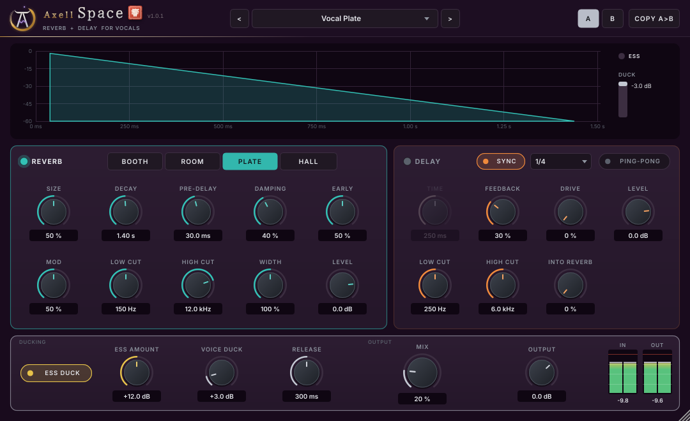

# Axell Space (VST3, Linux)

The space of the Axell suite: a reverb and a tempo-synced delay, made for vocals.
- **REVERB**: BOOTH, ROOM, PLATE and HALL from one 16-line feedback delay network with early reflections modelled on a
  real room's geometry. Dense from the first milliseconds, a smooth tail without metallic ringing, decay times that
  are what the knob says.
- **DELAY**: synced to the song (1/16 to 1/1, triplets and dotted) or free in milliseconds, exact to the sample;
  feedback, ping-pong, filters that darken and thin every repeat a little more, tape-like drive, and a send of the
  repeats into the reverb.
- **ESS DUCK**: the suite's sibilance network (from Axell Velvet 3.0) marks every S, SH and CH and keeps it out of
  the reverb and the delay - no splashy, hissing tails - while the voice itself is untouched.
- **VOICE DUCK**: the effects step back while you rap and bloom in the gaps.

> **Part of Axell's Dojo** - the Axell Signature suite for rap vocals, beats and masters on Linux:
> [Penta EQ](https://github.com/zmardanian/axell-penta-eq) · [Duo Compressor](https://github.com/zmardanian/axell-duo-compressor) ·
> [Gate](https://github.com/zmardanian/axell-gate) · [De-Reverb](https://github.com/zmardanian/axell-dereverb) ·
> [Velvet](https://github.com/zmardanian/axell-velvet) · [Master](https://github.com/zmardanian/axell-master) ·
> [Space](https://github.com/zmardanian/axell-space), installed, updated and tuned to your voice by the
> [Axell Signature Dojo](https://github.com/zmardanian/axell-signature-dojo). The plugins share one core library
> (`external/axell-core`): a breakthrough in one plugin becomes a feature of the next.

More screens: [1/4 throw](docs/screenshots/space-throw.png), [ad-lib tail](docs/screenshots/space-adlib.png),
[slap back](docs/screenshots/space-slap.png), [75 % size](docs/screenshots/space-75pct.png).

## What it does

**REVERB**
- **TYPE**: BOOTH (a small, dense booth around the voice), ROOM (a natural room, early reflections first), PLATE (the
  classic vocal plate, dense and bright from the start, no early reflections), HALL (big and long, for hooks).
- **SIZE**, **DECAY** (RT60, 0.2-10 s), **PRE-DELAY** (0-250 ms: the words stay in front, the space comes behind),
  **DAMPING** (how much faster the highs die: at 100 % the 8 kHz decay is twice as fast as the mids, at every sample
  rate), **EARLY** (the early reflections against the tail), **MOD** (slow movement that keeps the tail smooth; 50 %
  keeps any pitch wobble under about 7 cents), **LOW CUT** / **HIGH CUT** before the reverb, **WIDTH** (0-200 %),
  **LEVEL**.

**DELAY**
- **SYNC** with a **NOTE** value at the host's tempo, or **TIME** in milliseconds (1-2000).
- **FEEDBACK** (0-95 %), **PING-PONG**, **LOW CUT** / **HIGH CUT** inside the feedback loop, **DRIVE** (soft tape-like
  saturation of the repeats), **LEVEL**, **INTO REVERB** (the repeats melt into the space).

**DUCKING**
- **ESS DUCK** with its **AMOUNT** (0-24 dB): the effects' input is delayed by 8 ms so that the sibilance network can
  decide before an ess reaches them. The dry voice is not delayed: Space has **no latency**.
- **VOICE DUCK** (0-24 dB) and **RELEASE**: the effects go down while the voice is loud and come back in its pauses.

**OUTPUT**
- **MIX**: up to 50 % the voice stays at full level and the effects come in; above 50 % the voice goes down; 100 % =
  wet only, for a send / aux track. At 0 % the output is the input, bit for bit.
- **OUTPUT** level, IN / OUT meters, 13 factory presets (vocal plates, booth, rooms, hall, slap, throws, ping-pong,
  ad-lib tails and two 100 %-wet send presets), A/B.

Switching the reverb or the delay off lets its tail ring out; changing the type cross-fades; host bypass cross-fades
over 10 ms and is then the input, bit for bit.

## Measured quality

Impulse responses measured through a real VST3 host by an independent script (`tests/independent/space_audit.py`,
scipy, nothing from the plugin's code), wet only, filters open:

| | Booth | Room | Plate | Hall |
|---|---|---|---|---|
| Decay time (T30, 500 Hz-2 kHz) re the knob, 0.6 / 2 / 5 s | +3.5 / -1.8 / -0.2 % | +3.2 / -0.4 / -0.9 % | +2.1 / -0.8 / -0.4 % | +1.6 / +0.4 / +0.1 % |
| Echo density 0.9 reached after the first sound (Abel & Huang) | 10 ms | 10 ms | 15 ms | 20 ms |
| L/R correlation of the tail (IACC, 0.1-1 s) | 0.05 | 0.03 | 0.03 | 0.03 |
| Tail colour: fine-spectrum peaks over the 1/3-octave envelope (white noise: +8.1 dB) | +11.0 dB | +10.7 dB | +10.9 dB | +9.6 dB |

For reference, a well-regarded free open-source reverb measured the same way: echo density 10-35 ms, tail colour
+10.0 to +11.9 dB. Decay times stay within 5 % at 44.1, 48, 96 and 192 kHz.

**Delay**: repeats within 0.03 ms of the set time at 44.1-96 kHz (sync 1/4 at 120 BPM: 500.000 ms), FEEDBACK 50 % =
-6.02 dB per repeat, ping-pong separation > 170 dB.

**ESS DUCK** (independent synthetic voice, 44.1-96 kHz): esses in the effects -12.0 dB at AMOUNT 12 dB, no vowel
changed (0.00 dB). On the artist's own dry vocal: 85 % of the ess moments turned down by more than 6 dB (median
-12 dB), no vowel touched.

**VOICE DUCK** 12 dB: the reverb -11.8 dB while the voice sounds, back within 0.7 dB in the pauses.

**CPU**: 2.7-3.3 % of one core (stereo, 48 kHz, 128-sample blocks, Vocal Plate / Hall Hook / Ad-lib Tail presets).
No memory allocation while processing.

**Verified for 1.0.1**: DSP suite 118 checks, plugin suite 29, ASan + UBSan clean, independent audit 69/69,
pluginval strictness 10, Steinberg's VST3 validator 47/47.

## Install (Linux)

Download `AxellSpace-1.0.1-linux-x86_64.tar.gz` from the
[latest release](https://github.com/zmardanian/axell-space/releases/latest) (optional: `sha256sum -c SHA256SUMS.txt`), then:

    tar xzf AxellSpace-1.0.1-linux-x86_64.tar.gz
    cd AxellSpace-1.0.1-linux-x86_64
    ./install.sh

Then in REAPER: Options > Preferences > Plug-ins > VST > Re-scan. On a vocal track use MIX 15-30 %; on a send / aux
track use one of the "Send:" presets (100 % wet).

## Build (Bazzite / any Linux, inside a distrobox)

    bash scripts/setup-toolbox.sh
    bash scripts/build.sh
    bash scripts/test.sh               # DSP + plugin suites (--quick, --asan)
    bash scripts/pluginval.sh
    bash scripts/install.sh

The DSP lives in one JUCE-free header (`Source/Engine.h`) plus the shared Axell core in `external/axell-core` or
`../axell-core` (the sibilance network). `tools/SpaceRender.cpp` renders WAV files and impulse responses from the
command line; `research/irmeasure.py` measures impulse responses (decay, density, colour, IACC).

## Contact

Axell Yobag - axellpetre@protonmail.com. Issues on GitHub are welcome too.

Licence: GNU AGPLv3 (`LICENSE`); third-party components and the CMU ARCTIC and VCTK notices (training data of the
sibilance network) in `THIRD_PARTY_NOTICES.md`. No code, data, impulse responses or graphics of any commercial
product are used.
