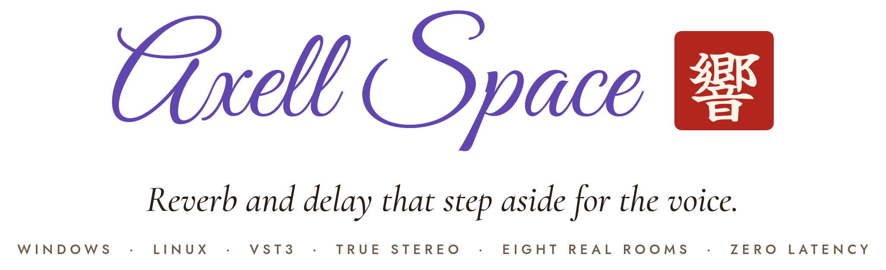
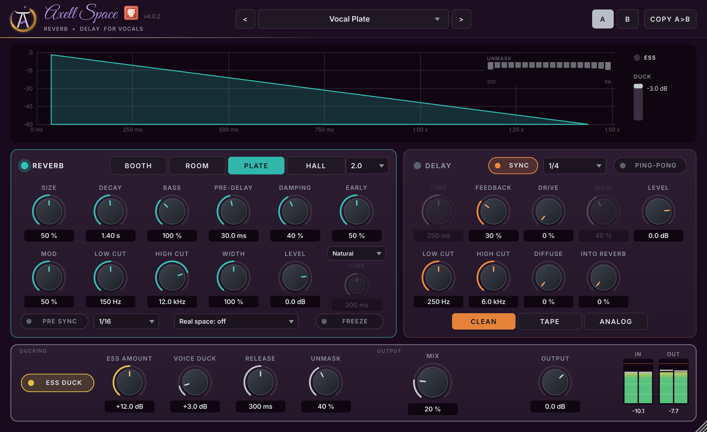
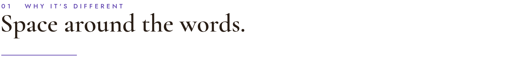
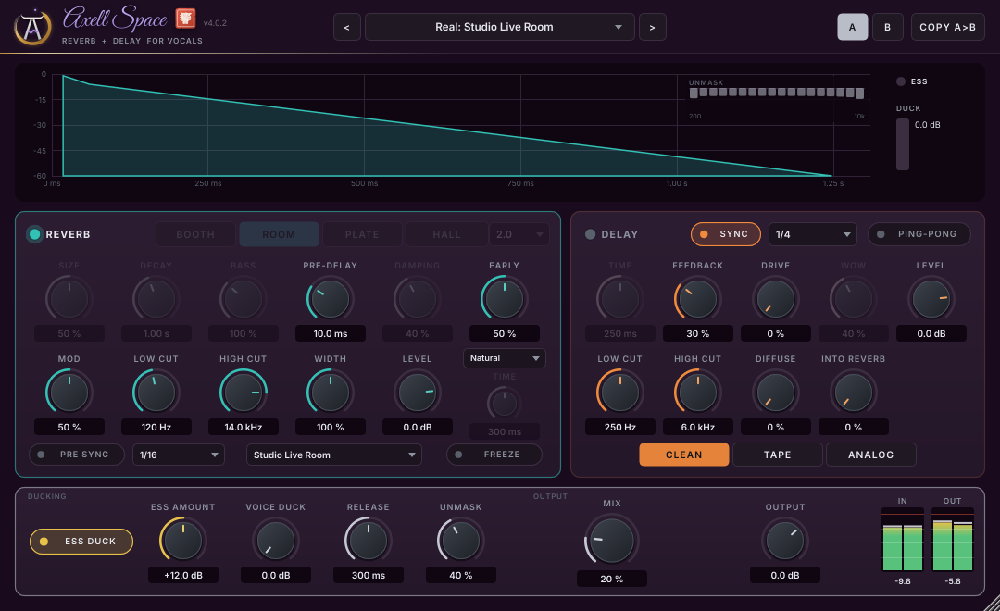
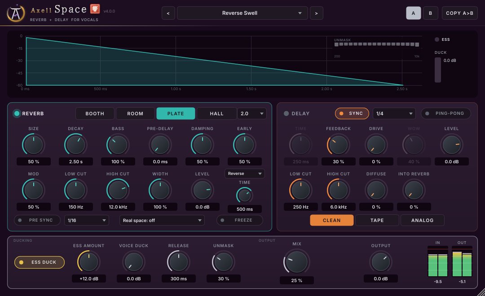
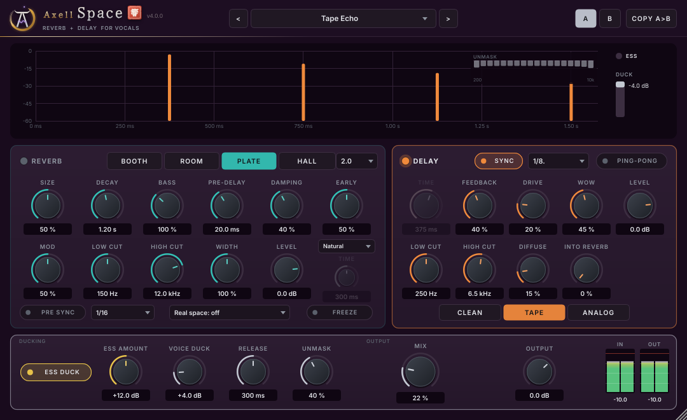
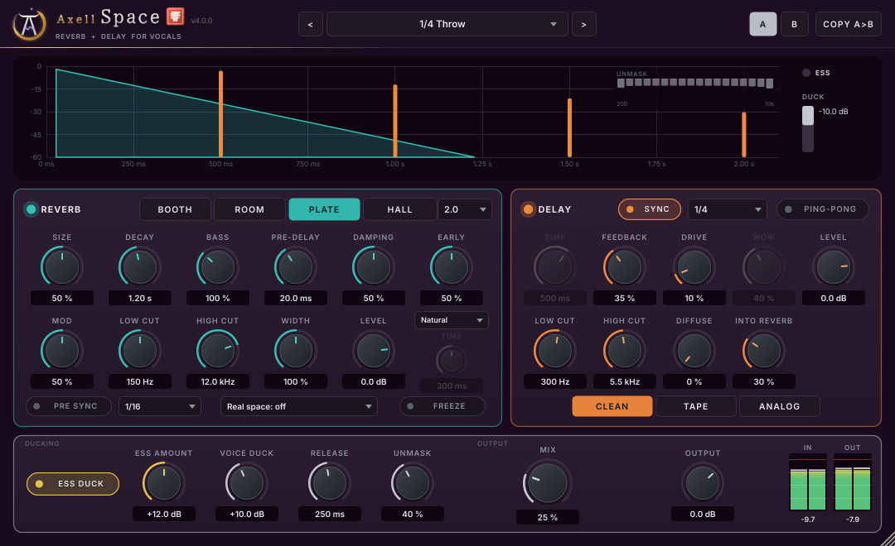
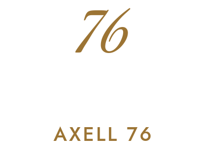
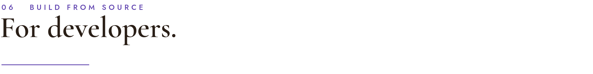

<picture>
  <source media="(prefers-color-scheme: dark)" srcset="docs/img/type/hero-dark.png">
  
</picture>

  
  
  
  
  
  

  

  <b>Reverb and delay that make room for the voice.</b> 
  A 32-line true-stereo reverb, eight real rooms modelled from their size and walls, and a tempo-synced delay - with ESS DUCK keeping the esses out of the tails and UNMASK stepping the effects back only where they cover your words.

  <a href="https://github.com/zmardanian/axell-space/releases/latest"><picture>
  <source media="(prefers-color-scheme: dark)" srcset="docs/img/type/dl-windows-dark.png">
  
</picture></a>
  &nbsp;&nbsp;
  <a href="https://github.com/zmardanian/axell-space/releases/latest"><picture>
  <source media="(prefers-color-scheme: dark)" srcset="docs/img/type/dl-linux-dark.png">
  
</picture></a>

Free and open source (AGPL-3.0)  ·  Windows 10 / 11 and Linux  ·  any VST3 host - FL Studio, Ableton Live, Cubase, Studio One, Bitwig, REAPER

 

<picture>
  <source media="(prefers-color-scheme: dark)" srcset="docs/img/type/h-why-dark.png">
  
</picture>

- **Eight REAL SPACES** - vocal booth, tiled bathroom, living room, live room, stairwell, small club, wood chapel, car park - held to their physics.
- **Tails without hiss** - ESS DUCK leaves the esses 28 dB under the vowels in the tail - the clearest of every reverb measured.
- **Decay you can trust** - the measured decay time within 3 % of the knob, dense within 15 ms, no metallic ringing.
- **Effects that step aside** - UNMASK ducks only the bands your voice is using at that moment.
- **Zero latency** - use it live, on a send or on the track.

 

<picture>
  <source media="(prefers-color-scheme: dark)" srcset="docs/img/type/h-does-dark.png">
  
</picture>

The space of the Axell suite: a reverb and a tempo-synced delay, made for vocals.
- **REVERB**: BOOTH, ROOM, PLATE and HALL from a 32-line, true-stereo feedback delay network with diffusion inside
  every loop, three-band decay and early reflections modelled on a real room's geometry. Dense from the first
  milliseconds, a smooth tail without metallic ringing, decay times that are what the knob says. **REAL SPACES** (4.0):
  eight real rooms modelled from their size and walls - booth, bathroom, living room, live room, stairwell, club, chapel,
  car park - held to their physics. **SHAPE**: natural, gated or reversed tails.
- **DELAY**: synced to the song (1/16 to 1/1, triplets and dotted) or free in milliseconds, exact to the sample;
  CLEAN, TAPE or ANALOG repeats, wow and flutter, diffusion, feedback, ping-pong, filters, drive, and a send of the
  repeats into the reverb.
- **ESS DUCK**: the suite's sibilance network (from Axell Velvet 3.0) marks every S, SH and CH and keeps it out of
  the reverb and the delay - no splashy, hissing tails - while the voice itself is untouched.
- **VOICE DUCK**: the effects step back while you rap and bloom in the gaps; **UNMASK** steps them back only in the
  bands your voice is using at that moment, so the space stays around the words.

More screens: [1/4 throw](docs/screenshots/space-throw.png), [ad-lib tail](docs/screenshots/space-adlib.png),
[slap back](docs/screenshots/space-slap.png), [75 % size](docs/screenshots/space-75pct.png).

**REVERB** (2.0: a new core - 32 lines, true stereo, three-band decay, voiced per type; sessions saved before 2.0 keep the
1.0 core, bit for bit, and **ENGINE** switches)
- **TYPE**: BOOTH (a small, dense booth around the voice), ROOM (a natural room, early reflections first), PLATE (the
  classic vocal plate, dense and bright from the start, no early reflections), HALL (big and long, for hooks).
- **SIZE**, **DECAY** (RT60, 0.2-10 s), **PRE-DELAY** (0-250 ms: the words stay in front, the space comes behind),
  **BASS** (2.0: the lows' decay, 50 - 200 % of DECAY), **DAMPING** (how much faster the highs die: at 100 % 2.5x
  faster than the mids in 2.0, 2x in 1.0), **FREEZE** (2.0: hold the tail, let nothing new in), **PRE SYNC** (pre-delay
  in note values of the tempo), **EARLY** (the early reflections against the tail), **MOD** (slow movement that keeps the tail smooth; 50 %
  keeps any pitch wobble under about 7 cents), **LOW CUT** / **HIGH CUT** before the reverb, **WIDTH** (0-200 %),
  **LEVEL**.

- **REAL SPACE** (4.0): a modelled room instead of the TYPE's algorithm: its own early reflections (true stereo) and a
  tail decaying per band as the room does; it sets DECAY and SIZE (they step aside). **SHAPE** (4.0): NATURAL, GATED
  (open while you rap and for TIME after, then shut) or REVERSE (the tail backwards in segments of TIME: a swell).

**DELAY**
- **MODE** (3.0): **CLEAN** (exact repeats), **TAPE** (soft record-head saturation, a head bump, each pass darker, the
  tape's wow and flutter) or **ANALOG** (a dark bucket-brigade line, soft clipping); **WOW** (how much the tape moves:
  40 % = a healthy machine, 1.5 cents; 100 % = a worn one, 4 cents) and **DIFFUSE** (each repeat smears a little more,
  from echoes to a soft trail, still on the beat).
- **SYNC** with a **NOTE** value at the host's tempo, or **TIME** in milliseconds (1-2000).
- **FEEDBACK** (0-95 %), **PING-PONG**, **LOW CUT** / **HIGH CUT** inside the feedback loop, **DRIVE** (soft tape-like
  saturation of the repeats), **LEVEL**, **INTO REVERB** (the repeats melt into the space).

**DUCKING**
- **ESS DUCK** with its **AMOUNT** (0-24 dB): the effects' input is delayed by 8 ms so that the sibilance network can
  decide before an ess reaches them. The dry voice is not delayed: Space has **no latency**.
- **VOICE DUCK** (0-24 dB) and **RELEASE**: the effects go down while the voice is loud and come back in its pauses.
- **UNMASK** (3.0, 0-100 % = up to 12 dB): the effects step back only where they would cover the voice - per third of an
  octave, while the voice uses that band - and stay full everywhere else. The display shows what it carves out, live.

**OUTPUT**
- **MIX**: up to 50 % the voice stays at full level and the effects come in; above 50 % the voice goes down; 100 % =
  wet only, for a send / aux track. At 0 % the output is the input, bit for bit.
- **OUTPUT** level, IN / OUT meters, 26 factory presets (vocal plates, booth, rooms, halls, seven real rooms, gated hall, reverse
  swell, tape slap and echo, throws, ping-pong, analog dub, diffuse trail, ad-lib tails and two 100 %-wet sends), A/B.

Switching the reverb or the delay off lets its tail ring out; changing the type cross-fades; host bypass cross-fades
over 10 ms and is then the input, bit for bit.

<table>
<tr><td align="center" width="50%"> REAL SPACES - eight real rooms</td><td align="center" width="50%"> SHAPE: reverse</td></tr>
<tr><td align="center" width="50%"> Delay: TAPE</td><td align="center" width="50%"> A vocal throw</td></tr>
</table>

 

<picture>
  <source media="(prefers-color-scheme: dark)" srcset="docs/img/type/h-measured-dark.png">
  
</picture>

Impulse responses measured through a real VST3 host by an independent script (`tests/independent/space_audit.py`,
scipy, nothing from the plugin's code), wet only, filters open:

| 2.0 core | Booth | Room | Plate | Hall |
|---|---|---|---|---|
| Decay time (T30, 500 Hz-2 kHz) re the knob, 0.6 / 2 / 5 s | -1.1 / -1.7 / -1.3 % | -1.4 / -2.8 / +0.2 % | -1.1 / +0.6 / +1.2 % | -1.6 / +1.8 / +0.1 % |
| Echo density 0.9 reached after the first sound (Abel & Huang) | 15 ms | 10 ms | 15 ms | 15 ms |
| L/R correlation of the tail (IACC, 0.1-1 s) | 0.03 | 0.04 | 0.03 | 0.03 |
| Tail colour, 200 Hz - 6 kHz, mean of 8 impulses (noise-like: 8.4 dB) | 10.0 dB | 9.9 dB | 9.2 dB | 8.9 dB |
| (1.0 core, the same measure) | 10.3 dB | 9.9 dB | 10.1 dB | 9.4 dB |

The same colour measure on a respected commercial plate: 9.3 dB; on a well-regarded open-source reverb: plate 8.9, hall
9.9, room 11.2 dB. On the artist's own dry vocal, used as a send with every wet matched in loudness: the 2.0 plate smears
the consonants by 2.0 dB (1.0: 3.0, the commercial plate 2.2) and leaves the esses 19 dB under the vowels in its tail
(1.0: 14) - 28 dB with ESS DUCK, the clearest of all measured.

**Delay**: repeats within 0.03 ms of the set time at 44.1-96 kHz (sync 1/4 at 120 BPM: 500.000 ms), FEEDBACK 50 % =
-6.02 dB per repeat, ping-pong separation > 170 dB.

**Delay MODE** (independent audit): CLEAN keeps every repeat's tone (repeat 3 re 1 at 10 kHz: -0.02 dB); TAPE darkens it
13 dB over two passes, ANALOG 39 dB. TAPE / ANALOG at FEEDBACK 95 % with DRIVE 60 die away (50 - 66 dB down after 14 s);
repeats on the beat within 0.3 ms with DIFFUSE; wow at 40 % 1.5 cents rms.

**UNMASK** (independent audit): while a 700 Hz voice holds, a hall's tail steps back 10.1 dB at 700 Hz and stays within
0.02 dB at 4-8 kHz. On the artist's dry vocal: as clear as VOICE DUCK 6 dB with 2.2 dB more of the space kept (3.3 dB more
in the bands the voice leaves free); added to the vocal presets (40 %): the voice 3.3 dB less covered and the consonants
clearer, for 1.5-2 dB less space. No zipper: artefacts at least 106 dB down.

**REAL SPACES** (independent audit, through a real host): the decay at 1 kHz of every room within 8 % of the room's
physics (Eyring's formula from its size and walls): booth 0.083 s (0.09), bathroom 0.85 (0.90), living room 0.32 (0.31),
live room 1.14 (1.23), stairwell 2.91 (3.07), club 0.83 (0.90), chapel 2.16 (2.19), car park 2.89 (2.92). The balance of
early and late energy within 0.4 dB of a full room simulation; the first reflection on time to 0.01 ms.

**ESS DUCK** (independent synthetic voice, 44.1-96 kHz): esses in the effects -12.0 dB at AMOUNT 12 dB, no vowel
changed (0.00 dB). On the artist's own dry vocal: 85 % of the ess moments turned down by more than 6 dB (median
-12 dB), no vowel touched.

**VOICE DUCK** 12 dB: the reverb -11.8 dB while the voice sounds, back within 0.7 dB in the pauses.

**CPU**: 4.25-5.0 % of one core with UNMASK on (stereo, 48 kHz, 128-sample blocks, Vocal Plate / Hall Hook / Ad-lib Tail
presets), a real room 5.6-5.7 %; UNMASK at 0 % costs nothing.
No memory allocation while processing.

**Verified for 4.0.3**: DSP suite 412 checks, plugin suite 34, ASan + UBSan clean, independent audit 91/91,
pluginval strictness 10, Steinberg's VST3 validator 47/47, pluginval 2.0 real-time check 31/31; 134 renders
byte-identical to 4.0.2 (4.0.3 only fades DELAY / REVERB in and out over 3 ms when they are switched: no click).

 

<picture>
  <source media="(prefers-color-scheme: dark)" srcset="docs/img/type/h-install-dark.png">
  
</picture>

### Windows

> [!TIP]
> **The whole suite in one go:** the [Axell Signature Suite installer](https://github.com/zmardanian/axell-signature-dojo/releases/latest) puts every Axell plugin and the Dojo on Windows 10 / 11 in one step, each one optional - and the Dojo keeps them up to date. Every VST3 host loads them: FL Studio, Ableton Live, Cubase, Studio One, Bitwig, REAPER.

Windows 10 / 11, 64-bit. Download `AxellSpace-<version>-windows-x64.tar.gz` from the
[latest release](https://github.com/zmardanian/axell-space/releases/latest) (optional: check it against `SHA256SUMS.txt`),
extract it (Windows 11 opens .tar.gz directly; on Windows 10 use 7-Zip or `tar -xzf` in a terminal) and copy the folder
`Axell Space.vst3` into `C:\Program Files\Common Files\VST3`. Then rescan plugins in your DAW.
Or install the whole suite in one go with the Axell Signature Suite installer from the
[Axell Signature Dojo releases](https://github.com/zmardanian/axell-signature-dojo/releases/latest) - the Dojo then keeps it up to date.

Every Windows build is made by GitHub Actions from this repository, passes the same test suites and pluginval
(strictness 10) as the Linux build, and is checked to sound the same as it (largest difference far below -90 dBFS,
most often bit-identical). The plugin is not code-signed yet; DAWs load it directly.

### Linux

Runs on x86_64 Linux with glibc 2.35 or newer: Ubuntu 22.04+, Debian 12+, Linux Mint 21+, Fedora 36+, Arch, Bazzite.

Download `AxellSpace-4.0.3-linux-x86_64.tar.gz` from the
[latest release](https://github.com/zmardanian/axell-space/releases/latest) (optional: `sha256sum -c SHA256SUMS.txt`), then:

    tar xzf AxellSpace-4.0.3-linux-x86_64.tar.gz
    cd AxellSpace-4.0.3-linux-x86_64
    ./install.sh

Then in REAPER: Options > Preferences > Plug-ins > VST > Re-scan. On a vocal track use MIX 15-30 %; on a send / aux
track use one of the "Send:" presets (100 % wet).

 

<picture>
  <source media="(prefers-color-scheme: dark)" srcset="docs/img/type/h-suite-dark.png">
  
</picture>

<table>
<tr><td align="center"><a href="https://github.com/zmardanian/axell-penta-eq"><picture>
  <source media="(prefers-color-scheme: dark)" srcset="docs/img/suite/penta-eq-dark.png">
  
</picture></a> analog-matched EQ</td><td align="center"><a href="https://github.com/zmardanian/axell-duo-compressor"><picture>
  <source media="(prefers-color-scheme: dark)" srcset="docs/img/suite/duo-compressor-dark.png">
  
</picture></a> FET + opto + limiter</td><td align="center"><a href="https://github.com/zmardanian/axell-gate"><picture>
  <source media="(prefers-color-scheme: dark)" srcset="docs/img/suite/gate-dark.png">
  
</picture></a> voice-aware gate</td><td align="center"><a href="https://github.com/zmardanian/axell-dereverb"><picture>
  <source media="(prefers-color-scheme: dark)" srcset="docs/img/suite/dereverb-dark.png">
  
</picture></a> small-room de-reverb</td><td align="center"><a href="https://github.com/zmardanian/axell-velvet"><picture>
  <source media="(prefers-color-scheme: dark)" srcset="docs/img/suite/velvet-dark.png">
  
</picture></a> neural de-esser + warmth</td></tr>
<tr><td align="center"><a href="https://github.com/zmardanian/axell-master"><picture>
  <source media="(prefers-color-scheme: dark)" srcset="docs/img/suite/master-dark.png">
  
</picture></a> mastering limiter</td><td align="center"><a href="https://github.com/zmardanian/axell-space"><picture>
  <source media="(prefers-color-scheme: dark)" srcset="docs/img/suite/space-dark.png">
  
</picture></a> vocal reverb + delay</td><td align="center"><a href="https://github.com/zmardanian/axell-forbidden-seal"><picture>
  <source media="(prefers-color-scheme: dark)" srcset="docs/img/suite/forbidden-seal-dark.png">
  
</picture></a> saturation</td><td align="center"><a href="https://github.com/zmardanian/axell-76"><picture>
  <source media="(prefers-color-scheme: dark)" srcset="docs/img/suite/76-dark.png">
  
</picture></a> 1176 FET compressor</td><td align="center"><a href="https://github.com/zmardanian/axell-signature-dojo"><picture>
  <source media="(prefers-color-scheme: dark)" srcset="docs/img/suite/signature-dojo-dark.png">
  
</picture></a> the suite's home</td></tr>
</table>

Nine plugins and their home, built as one family: they share a core library, so a breakthrough in one becomes a feature of the next - the sibilance network of Velvet guards the esses in Duo, Master, Space and Forbidden Seal; Gate's voice detector holds Duo's and Master's gain through your pauses. The [Axell Signature Dojo](https://github.com/zmardanian/axell-signature-dojo) installs, updates and tunes the whole suite to your voice - on Windows from a single installer.

 

<picture>
  <source media="(prefers-color-scheme: dark)" srcset="docs/img/type/h-build-dark.png">
  
</picture>

    bash scripts/setup-toolbox.sh
    bash scripts/build.sh
    bash scripts/test.sh               # DSP + plugin suites (--quick, --asan)
    bash scripts/pluginval.sh
    bash scripts/install.sh

The DSP lives in one JUCE-free header (`Source/Engine.h`) plus the shared Axell core in `external/axell-core` or
`../axell-core` (the sibilance network). `tools/SpaceRender.cpp` renders WAV files and impulse responses from the
command line; `research/irmeasure.py` measures impulse responses (decay, density, colour, IACC).

 

<picture>
  <source media="(prefers-color-scheme: dark)" srcset="docs/img/type/h-credits-dark.png">
  
</picture>

**Free forever, kept alive by you.** Axell Space costs nothing and never will - no subscriptions, no licence keys. If it has earned a place in your mixes, you can [support the Dojo on Ko-fi](https://ko-fi.com/axellyobag) - one-time or monthly, from €3.

Axell Yobag - contact@axellsdojo.com. Issues on GitHub are welcome too.

Licence: GNU AGPLv3 (`LICENSE`); third-party components and the CMU ARCTIC and VCTK notices (training data of the
sibilance network) in `THIRD_PARTY_NOTICES.md`. No code, data, impulse responses or graphics of any commercial
product are used.

 

From the November 2026 releases on, `SHA256SUMS.txt` is signed with the suite's release key: `minisign -Vm SHA256SUMS.txt -P RWQJLVJSETsP7RRz1rdiugX9w09wtGCtwEc5hHU8k9S+crL/ekfTkQKG`, then `sha256sum -c --ignore-missing SHA256SUMS.txt` (the Axell Signature Dojo checks both itself). How releases are built and signed: [code signing policy](https://www.axellsdojo.com/code-signing/).

<picture><source media="(prefers-color-scheme: dark)" srcset="docs/vst-compatible-dark.svg"></picture>

VST is a registered trademark of Steinberg Media Technologies GmbH. 1176, 1176LN, LA-2A, UADx and Universal Audio are trademarks of their respective owners. The Axell plugins are independent works, not affiliated with or endorsed by them; the names only describe what was measured and compared.
